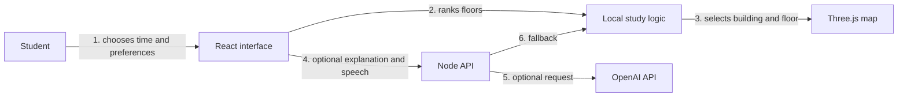

# Architecture and data limits

## How the app works

The React client holds the selected campus, time, floor and effect settings in memory. `src/data/campusData.ts` owns seven campus profiles and 27 named buildings. `src/utils/campusLogic.ts` owns all time-based occupancy estimates and study ranking. The Three.js scene renders this data directly and rebuilds only when the campus changes. It keeps the camera interactive through OrbitControls.

The local path is the baseline. `POST /api/ai/concierge` accepts a query, campus ID and hour. Without `AI_API_KEY`, it returns the local recommendation. With a key, the server sends only a short list of candidate floors and accepts a structured answer only when its building and floor match that list. Provider failures return the local result. The finder shows query count and model tokens; cost is estimated only when rates are configured. `POST /api/ai/tts` returns MP3 speech when configured; the client uses browser speech when it is not. The key never reaches the browser.

## What the map means

The bundled buildings are simplified boxes and landmark shapes placed in a stylized campus grid. They are **not** surveyed footprints or a navigable walking route. GeoJSON imports extrude uploaded polygons. A written description generates three illustrative floors; neither path verifies floor uses, heights or opening hours. The PDF and GeoJSON exports are labelled schematic for the same reason.

The time slider applies a deterministic daily curve to each floor's authored baseline. Free seats are the estimated occupancy percentage applied to the floor capacity. Noise is adjusted from occupancy and study type. No university occupancy feed, microphone reading or student report is connected. Check each university map and booking page before travelling.

## Map sources

The university links in the interface are verified official pages, used for names and campus context:

- [UCL Bloomsbury and UCL East maps](https://maps.ucl.ac.uk/downloads/)
- [King's Strand campus PDF](https://www.kcl.ac.uk/assets/pdf24/strand-campus-map-2025.pdf)
- [Imperial campus map](https://www.imperial.ac.uk/study/visit/undergraduate/open-days/campus-map/) and [White City information](https://www.imperial.ac.uk/white-city-campus/find-us/)
- [LSE campus map and building guide](https://www.lse.ac.uk/lse-information/campus-map)

## Controls and fallback

The scene supports rotate, zoom, building selection and reset. Heatmap colours show occupancy bands, and flow points show an illustrative animation. The time slider controls day, dusk and night lighting. Tour narration, generated sound and optional AI calls start only after user actions. The guided tour has pause, resume, previous, next, replay, voice toggle and exit. Escape closes the floor explorer and tool drawer.

For a reliable demo, no external map tile service, Google Maps key, database or AI key is required. Imported buildings and captured photos remain in the current browser session; reloading clears them. Photo studio can download individual captures or combine them into a contact sheet.
